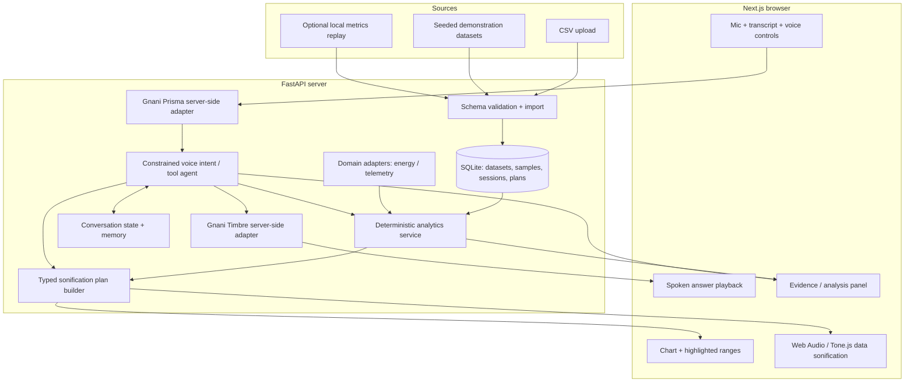

# SonicLens — End-to-End Product Requirements Document and Codex Execution Contract

**Status:** Implementation-ready MVP specification; product direction updated 29 October 2026  
**Version:** 1.1  
**Product:** SonicLens — *Talk to your data. Watch the insights unfold.*  
**Primary delivery:** Fully functional localhost web application, source code, documentation, deterministic test evidence, and an authentic Gnani-powered spoken demo where credentials are available.

> **Codex instruction:** Treat this document as the authoritative product and engineering contract. Inspect the repository and environment first, implement the MVP from end to end, run and repair tests, visually inspect the browser application where tooling permits, and finish with explicit evidence against every acceptance criterion. Do not stop at a plan or mock UI. Work through the goal loop in §17 within your available execution session. Never claim successful live Gnani calls without actually making them.

> **Product-direction update:** The user's `SonicLens — Complete Codex Master Prompt` supplied on 29 October 2026 supersedes any conflicting framing below. SonicLens is a voice-native, goal-oriented data analyst that presents validated findings through interactive visual scenes. Sonification is a secondary tool; energy remains a demonstration domain, not the product identity.

---

## 1. Product concept and user promise

SonicLens is a **voice-native conversational data intelligence platform**. A user selects or imports a structured dataset and speaks an analytical goal. The analyst performs bounded deterministic calculations and presents the findings through coordinated outputs:

1. **Gnani-generated spoken explanations** that users can interrupt and redirect.
2. **Interactive visual presentation scenes** that change the chart, highlight the relevant interval and expose supporting evidence.
3. **Grounded numerical analysis** (actual calculations, not model guesses).
4. Optional question-conditioned sonification as a supplementary way to inspect a trend or comparison.

The product should feel like a data analyst presenting findings live: the analyst speaks, the relevant chart changes, evidence remains inspectable, and spoken follow-ups revise the goal without losing context. SonicLens makes no claims that narration establishes causality or replaces evidence.

### Core user problem

People often need to inspect several charts and reports to answer one analytical question. SonicLens tests whether **voice-directed investigation + live visual presentation + evidence-linked spoken explanation** makes that exploration more direct. Nonverbal sonification is an optional aid, not the main interaction.

### Audience and application strategy

**Core platform:** General time-series datasets. No hard-coded ML training concepts in the product core.

**MVP demonstration domain:** Household/building electricity usage. User investigates spikes, compares days and estimates cost using an explicitly supplied tariff. Uses prepared synthetic data and CSV uploads; **no physical meter or real utility API**.

**Second demonstration domain:** General telemetry such as API latency/error count. Both domains use the same conversational analyst, deterministic analysis and presentation engine. An optional ML experiment adapter may come later but **is not required** to pass MVP.

**Future adapters, NOT launch commitments:** ML training, research data, classroom function exploration, accessibility-tested data analysis, continuous monitoring, narrated storytelling.

### Competitive positioning and accuracy

Conversational analytics, voice interfaces and data presentation already exist; do not claim to be first. The proposed differentiator is a **bounded voice-led investigation that controls validated visual scenes, retains context, and grounds each spoken finding in deterministic analysis and inspectable evidence**.

No claims of improved accessibility, faster anomaly detection, reduced cognitive load, or business ROI may be presented as established without real user evaluation.

---

## 2. MVP boundaries and non-goals

### Must build

- Next.js + TypeScript browser application with polished, responsive desktop-first UI.
- FastAPI/Python API with typed schemas, SQLite persistence, and seeded demonstration datasets.
- Upload of a valid CSV containing a time column and one or more numeric series.
- One interactive workspace with selectable dataset, series, range and analysis mode.
- Voice-first analytical workflow with a visible listening/transcription/investigation/narration state and typed fallback.
- Bounded, evidence-grounded analytical tools and dataset-aware conversational session memory.
- Validated presentation scenes for overview, trend, anomaly, period comparison and numerical evidence; scenes control the actual chart and can be revisited.
- Push-to-interrupt narration: microphone activation stops current audio and redirects the active investigation; stale requests cannot replace the newer scene.
- Gnani-generated short spoken explanations alongside scene-specific charts and inspectable evidence.
- Optional supplementary sonification modes: trend, anomaly-focused, and comparison/difference, with playback speed, pause, stop, volume and range.
- Numerical analysis: descriptive stats, peaks, abrupt changes, period comparisons and aligned-series differences.
- Conversational speech pipeline using **Gnani Prisma STT** and **Gnani Timbre TTS**.
- A constrained intent/tool-calling layer with session context for natural follow-ups.
- Evidence-linked spoken responses; narration and sonification never compete.
- Voice-led **Energy** and **Telemetry** demo scenarios with synthetic data, plus custom CSV exploration.
- Recording/replay of a complete working demo with deterministic reset.
- Automated backend, frontend/unit and end-to-end tests; honest credential-conditional integration verification.

### Explicitly not in MVP

- Production alerting, arbitrary real-time data connectors, telephony, IoT equipment, Google/Grafana/W&B integrations, fine-tuning ASR/TTS models, accounts/teams, subscription billing, high-stakes monitoring, accessibility certification, audio-to-video creation, arbitrary chart-image extraction, 3D audio, full multi-agent orchestration, or an unconstrained agent running code.

### Critical scope constraint

**Only two complete demo domains are required:** `energy` and `generic_telemetry`, sharing the same dataset model, analysis tools and presentation engine. Sonification is supplementary. Do not implement full ML monitoring first. Add ML only after all MVP acceptance criteria pass and time remains.

---

## 3. User journeys and behavior

### UJ-01 — First-run exploration

1. User opens `http://localhost:3000`.
2. A seeded energy dataset loads with units, time coverage and data-quality summary.
3. User presses **Play trend**; actual nonverbal audio plays after explicit user interaction.
4. Chart cursor and highlighted point progress in lockstep with sound.
5. User can stop, replay and select a subset of the time range.

**Success:** Without credentials, charts, data analysis and sonification work completely; voice is visibly marked unavailable until configured.

### UJ-02 — Authentic voice question

1. User presses microphone button and says in English, e.g., “Play the hours when electricity use increased sharply.”
2. Audio is sent **server-side** to Prisma; recognized words appear, visibly labeled as live STT.
3. Agent resolves the active dataset, calls a deterministic change/anomaly tool, and produces a typed `SonificationPlan`.
4. Selected intervals highlight on chart and become audible.
5. Timbre synthesizes an explanation reporting the actual dates, values and units. User can inspect numerical evidence alongside it.

**Success:** No hard-coded response for the particular phrase; alternate phrasings route through the same tool contract.

### UJ-03 — Conversational follow-up

1. User says: “Compare that with the previous day.”
2. System reuses the active interval and metric, resolves the previous-day aligned period, and obtains calculated differences.
3. Both the chart and sounds change; voice response reports the difference and any ambiguity in coverage.
4. User says: “Replay only the biggest difference, more slowly.”
5. System zooms to the correct interval and slows audio, without losing prior context.

**Success:** Reproducible tests confirm pronouns such as “that” resolve to the current range/event, not stale unrelated state.

### UJ-04 — Energy value

1. User asks: “Which evening cost the most this week?”
2. Backend integrates interval energy use (kWh) or uses supplied kWh interval quantities, multiplied by the **user-entered tariff in currency/kWh**.
3. Results specify whether data represents interval energy or power sampled over time. **Never infer kWh directly from raw kW without interval duration/integration.**
4. Agent speaks the result; user can see selected intervals and the calculation.

**Success:** No fabricated tariff, units or savings; user can change tariff and get recalculated numbers.

### UJ-05 — Cross-domain generality

User switches from Energy to Telemetry and asks “Compare errors and latency around the biggest spike.” The platform uses the same data and sound engine while domain adapters supply units, metric descriptions and optional rule presets.

**Success:** No cross-domain context leakage; the request and generated sound use the telemetry dataset.

### UJ-06 — Noisy/ambiguous/missing inputs

Unknown metric, ambiguous period, empty dataset, invalid file or uncertain STT results result in a targeted clarification or actionable error. Never silently guess a dataset field or return a plausible-but-false number.

### UJ-07 — Nonvisual-capable basics

Playback controls are keyboard-operable; chart data have adjacent accessible descriptions and tables; focus states and labels are present. This is a baseline of inclusive design, **not a claim of validated screen-reader accessibility**.

---

## 4. End-to-end architecture



### Responsibilities and prohibitions

- **Backend owns facts:** validated data, unit semantics, numerical computations, event detection, analysis IDs and generated audio-plan metadata.
- **Frontend owns audio synthesis and visualization:** follow a typed plan, never invent datasets or calculation results; same timestamps/indices drive graph highlights and sound events.
- **Agent owns orchestration and explanation:** turns speech into constrained validated operations; cannot run arbitrary shell/Python, write SQL, fabricate metrics or directly set claim values.
- **Session memory owns conversational referents:** selected dataset, metrics, date range, most recent comparison and most recent evidence-bearing event; does not overwrite source data.
- **Gnani owns speech I/O:** Prisma is genuine speech recognition and Timbre is genuine spoken response generation; Web Audio API generates *non-speech data sounds*. Never attribute those sounds to Gnani.

---

## 5. Technical stack, repo and dev experience

### Stack

| Area | Chosen technology |
|---|---|
| Web | Next.js App Router, React, TypeScript, Tailwind CSS, Lucide |
| Data chart | Recharts or visx; choose one and keep cursor synchronization accurate |
| Audio | Web Audio API; Tone.js if it materially simplifies safe scheduling |
| Backend | Python 3.11+, FastAPI, Pydantic v2, SQLAlchemy or SQLModel |
| Numerical | NumPy, Pandas, SciPy only if needed |
| Storage | SQLite for datasets, sessions and analyses; local private files for uploads |
| Agent | Structured-output/tool-calling LLM interface, configurable provider |
| Speech | Gnani Prisma and Timbre, server-side credential use |
| Testing | pytest, Vitest, Playwright or equivalent browser E2E |

### Proposed repository

```text
soniclens/
  apps/
    web/
      app/
      components/{shell,charts,audio,voice,analysis,datasets}/
      hooks/
      lib/{api,types,sonification,session}/
      tests/
    api/
      app/
        main.py
        config.py
        db/
        schemas/
        routers/{health,datasets,analytics,sonification,voice,sessions,demo}.py
        services/{importer,units,analytics,events,sonification,context,agent}.py
        adapters/{base,energy,telemetry}.py
        providers/{speech_base,gnani,fixture,reasoning}.py
      tests/
  data/
    fixtures/{energy_week.csv,api_telemetry.csv,energy_invalid.csv}
  scripts/{seed_demo.py,smoke_test.py}
  docs/{ARCHITECTURE,API,SONIFICATION,GNANI_SETUP,DEMO,DECISIONS}.md
  PRD.md
  GOALS.md
  PROGRESS.md
  .env.example
  .gitignore
  README.md
```

### Required local commands

`npm run dev` for frontend at `http://localhost:3000` (or documented equivalent), API at `http://localhost:8000`, health endpoint `/api/health`, API schema `/docs`, test commands and an optional root `make dev` / `just dev` / PowerShell helper. Specify environment variables and Windows-friendly instructions.

---

## 6. Data model, import and unit semantics

### Entities

**Dataset**: `id`, `name`, `domain`, `source`, `time_column`, `timezone`, `sampling_kind`, `sampling_interval`, `created_at`, `metric_descriptors`, `row_count`.

**MetricDescriptor**: `key`, `label`, `unit`, `kind`, `aggregation`, `higher_is_worse` nullable, `description`.

**Observation**: `dataset_id`, `timestamp` (UTC normalized), `sequence_index`, `values: {metric_key: number|null}`.

**AnalysisEvent**: `id`, `dataset_id`, `metric_keys`, `start_time`, `end_time`, `kind`, `severity`, `method`, `parameters`, `evidence`, `created_at`.

**SonificationPlan**: `id`, `dataset_id`, `analysis_id`, `mode`, `metric_keys`, `range`, `normalization`, `numeric_bounds`, `events[]`, `audio_profile`, `duration_ms`, `explanation_refs[]`.

**VoiceSession**: `id`, `active_dataset`, `active_metric_keys`, `active_range`, `last_event_id`, `last_comparison_id`, `last_sonification_plan_id`, `language`, `turns[]`.

### Valid CSV contract

- One parseable time column and at least one numeric metric.
- Accept ISO dates and common timestamp formats with clear mapping confirmation; reject truly ambiguous dates rather than silently swapping month/day.
- Default maximum upload **10 MB** and **50,000 rows** (configurable). Enforce both; graceful errors.
- Handle missing values, duplicate timestamps, out-of-order rows, NaN/Infinity and unit ambiguities explicitly. Document behavior.
- No automatic inference that columns are energy, kWh or money based solely on numeric shape.
- At import, show inferred descriptors and allow user to correct metric unit and kind.
- Compare only compatible units; normalize for audio presentation using documented shared scaling, never to compute physical differences across unlike units.

### Energy dataset

Supply synthetic hourly **interval energy (kWh)** over seven days, with several meaningful peak periods, daily patterns and a deliberately unusual evening. Tariff is user-configurable (default demo assumption explicitly labeled, e.g. ₹8/kWh). Cost = sum of interval kWh × tariff. If power is in kW, integrate over known interval duration first. No estimated savings without a stated counterfactual.

### Telemetry dataset

Synthetic timestamps with `latency_ms`, `error_count`, `request_count`. Display units. Allow aligned time-window comparison of latency and errors but do not claim causation from correlated spikes.

### Seed reproducibility

Use deterministic random seed; store fixture metadata indicating **synthetic** origin. Tests use known expected peaks, anomalies, and cost totals, not eyeballed charts.

---

## 7. Deterministic analytics and explanations

Implement typed tools (Pydantic I/O):

1. `list_datasets()`
2. `get_dataset_schema(dataset_id)`
3. `select_metrics(dataset_id, metric_keys)`
4. `get_range_summary(dataset_id, keys, start, end)`
5. `find_peaks(dataset_id, key, range, options)`
6. `find_abrupt_changes(dataset_id, key, range, options)`
7. `compare_periods(dataset_id, key, window_a, window_b)`
8. `compare_series(dataset_id, key_a, key_b, range, alignment)`
9. `energy_cost(dataset_id, range, tariff, currency)` — energy adapter only
10. `build_sonification_plan(mode, dataset_id, metrics, range, analysis_id, options)`
11. `get_event_evidence(event_id)`
12. `select_focus(session_id, range, metrics)`

Algorithms and semantics:

- Median, mean, min, max, count, delta, and slope as appropriate.
- Abrupt change = robust z-score / median absolute deviation or threshold on consecutive deltas; algorithm and parameters recorded in response.
- Peak = local maximum after optional smoothing, with clear edge behavior.
- Period comparison = equal-duration aligned windows with handling for missing samples.
- Series relationship = separate units and optional normalized visualization; report correlation only if a suitable overlapping sample count exists and label it as association, not cause.
- Group events into a limited number of interpretable segments; avoid labeling every small fluctuation an anomaly.
- Return `insufficient_data` when evidence does not support a conclusion.
- Every spoken factual statement about data must be reproducible from structured outputs; allow “I can't determine why from these metrics alone.”

**Example grounded analysis (illustrative values only):**

```json
{
  "analysis_id": "ana_001",
  "dataset_id": "energy_demo",
  "operation": "compare_periods",
  "metric": "energy_kwh",
  "period_a": {"start": "2026-10-20T18:00:00+05:30", "end": "2026-10-20T22:00:00+05:30", "total": 12.5},
  "period_b": {"start": "2026-10-21T18:00:00+05:30", "end": "2026-10-21T22:00:00+05:30", "total": 17.0},
  "difference": 4.5,
  "unit": "kWh",
  "evidence_row_ids": ["row_18", "row_19"]
}
```

Fixtures and expected outputs must be generated/verified together; never hardcode a contradictory backend explanation.

---

## 8. Supplementary sonification contract

Sonification remains available for users who want to listen to a trend, anomaly or comparison. It is secondary to the voice-led presentation and must not compete with narrated analysis.

**Sonification = non-speech audio generated from numbers. Timbre TTS = speech. They are distinct audio channels.**

### Audio mode A: Trend

- Time advances left to right.
- Sample values map to pitch within a safe, comfortable bounded frequency range; e.g. 220–880 Hz, configurable.
- Use one short envelope-shaped tone per downsampled point, or smooth transitions where appropriate.
- Higher values produce higher pitch *within the current documented scale*.
- Include chart cursor and data tooltip at each audible point.
- Provide audio legend: “higher pitch = higher metric value”; do not imply 'higher is good'.

**Mapping example:** `pitch = f_min * (f_max / f_min) ** clamp((v - v_min)/(v_max-v_min),0,1)`; choose sensible constant mapping when `v_min == v_max`. Maintain a **shared fixed numeric scale for comparisons** and show that range in UI; user should not have to infer scale changes.

### Audio mode B: Anomaly Focus

- Backend selects evidence-supported peaks / changes.
- Render **only selected intervals**, with clear short markers and enough context before and after the event to convey shape.
- Event type can affect a short earcon motif; ensure volume limited, no loud sirens.
- The user's query changes *which intervals are played*; not simply a prerecorded warning.

### Audio mode C: Comparison / Difference

- Same-unit aligned series or periods only for direct numerical difference sonification.
- Shared pitch range across A/B playback. Preferred MVP playback = sequential A → B, with explicit spoken/on-screen labels.
- Optionally support difference contour (signed difference maps to two distinct timbres, with legend); do not block MVP on sophisticated stereo layering.
- If units incompatible, provide comparison of separately described trends but decline a direct numeric difference.

### Question-conditioned plan

Tool outputs a data-backed plan; sample:

```json
{
  "dataset_id": "energy_demo",
  "mode": "anomaly",
  "metric_keys": ["energy_kwh"],
  "range": {"start": "2026-10-20T00:00:00+05:30", "end": "2026-10-27T00:00:00+05:30"},
  "event_ids": ["event_17", "event_22"],
  "normalization": "dataset_fixed",
  "playback_speed": 1.0,
  "sound_profile": "soft_tone",
  "analysis_id": "ana_011"
}
```

### Audio implementation safety and integrity

- Browser user gesture required before AudioContext activation.
- Real Play/Pause/Stop/Replay/Speed/Volume controls; mute works immediately.
- Clamp amplitude and frequency, use attack/release envelopes, release AudioNodes on completion.
- Never layer TTS over full-volume sonification: duck or pause sound when spoken explanation plays.
- Make event schedule deterministic; one clock drives audio and cursor to avoid drift.
- Cancellation cleans up active nodes and animation frames.
- Limit rendered density (e.g. at most 150 audible points per short preview) using a documented downsampling rule; don't silently alter the analytical result.
- Support keyboard access and descriptive legend.
- No copyrighted songs, melodies or audio samples; synthesize original neutral motifs only.

### Audio usefulness criterion

A completed demo must include **two distinctly different audible representations of the same dataset caused by two different spoken analytical requests**, with evidence showing why selected intervals differ. This is the primary novelty demonstration.

---

## 9. Gnani voice integration — must be authentic

The voice experience is a **first-class product mode**, not decorative narration. A user should be able to load a seeded dataset and complete the basic exploration using voice without operating analysis buttons (the initial browser permission and audio unlock can remain manual).

### Verified documentation links (checked 28 Oct 2026)

- Prisma real-time streaming: https://docs.gnani.ai/api/STT/stt-websocket
- Prisma STT overview / REST: https://docs.gnani.ai/api/STT/speech-to-text
- Timbre REST: https://docs.gnani.ai/api/TTS/tts-inference
- Timbre streaming: https://docs.gnani.ai/api/TTS/tts-websocket

**Prisma streaming documentation currently describes** `wss://api.vachana.ai/stt/v3/stream`, requires `x-api-key-id`, and documents `lang_code`, `x-model` and audio PCM framing and `transcript` events. **Timbre REST documentation currently demonstrates** `POST https://api.vachana.ai/api/v1/tts/inference` with `X-API-Key-ID`, text, model and audio configuration. Verify the latest docs and account-entitled model/voices before coding final payloads. Do not assume a model or language is provisioned just because the docs list it.

### Expected behavior

1. Browser captures microphone audio on push-to-talk.
2. Backend receives audio and performs format conversion if necessary (correct PCM sample rate/channels), then sends it to Gnani.
3. Recognized transcript is displayed with request status.
4. Agent turns the transcript into a typed intent, invokes deterministic tools, updates UI and audio plan.
5. Explanation text is synthesized through Gnani Timbre via backend; response audio plays in browser.
6. Microphone and data-audio playback never interfere in a way that generates feedback loops.

**Implementation priority:** Working 1-utterance push-to-talk path before full duplex/continuous streaming. Streaming is preferred but must not jeopardize a working demo. If using REST for recorded chunks, label it accurately. Do not substitute browser Web Speech as the official Gnani path.

### Environment

- `GNANI_API_KEY` (server only, never browser)
- `GNANI_STT_MODEL` / `GNANI_TTS_MODEL` configurable
- `GNANI_STT_LANGUAGE` configurable, verify supported Hindi-English code-mix configuration
- `GNANI_TTS_VOICE` optional configured according to documentation
- `REASONING_PROVIDER`, `REASONING_MODEL`, `REASONING_API_KEY` or equivalent; do not assume Gnani Evon is a hosted API. Support a configurable compatible model and deterministic fixture parser for tests.
- `.env.example` contains placeholders only.

### Fixture vs live

- Real provider adapter + fake fixture provider behind explicit `SPEECH_MODE=live|fixture`.
- Fixture mode allows offline tests and UI development; every screen must visibly disclose `Demo speech fixtures`.
- **Never mark DoD voice integration as passed** unless authenticated Prisma and Timbre API requests genuinely complete.
- If the user has not supplied credentials, deliver the tested adapter, exact setup instructions and status `BLOCKED_EXTERNAL` rather than claiming success.

### Resilience

Handle mic permission, audio conversion, timeout, 401/403, 429, exhausted credits, empty transcript, unsupported language, TTS failure, network disconnect, and invalid provider payload; bound retries and retain text explanations if TTS fails.

---

## 10. Agent and memory specification

This is **a constrained tool-using conversational agent**, not an unrestricted autonomous background agent.

### Intent schema

Possible intent categories: `select_dataset`, `select_metric`, `play_trend`, `play_anomalies`, `compare_periods`, `compare_metrics`, `focus_range`, `replay`, `pause`, `stop`, `change_speed`, `ask_value`, `ask_why`, `set_tariff`, `clarify`.

Extract slots: dataset, metric(s), time range, event reference, comparison target, audio mode, speed, tariff and preferred language. Validate against actual dataset metadata and units.

### Plan, execute, verify loop

On each utterance:

1. Interpret transcript + bounded session context.
2. Decide a supported intent and tool call.
3. Validate parameters and authorization of available datasets.
4. Execute deterministic tool(s).
5. Validate result against source data and required evidence.
6. Generate audio plan + UI state update.
7. Create grounded spoken explanation or request clarification.
8. Persist updated context and evidence IDs.

No repeated open-ended multi-step thinking after the goal is achieved. Limit steps, failures and external model usage per turn. Never permit a reasoning model to silently invent new numerical facts.

### Session memory

Persist session ID, current dataset, selected metrics, focus range, last analysis/event/plan, preferred language, last 10 turns, last comparison, updated timestamp.

- “that spike” resolves to `last_event_id`.
- “previous day” resolves relative to selected period and the dataset timezone.
- Changing dataset clears or validates stale event references.
- Unknown referents trigger one clarifying question.
- Provide `Reset conversation` to clear context without deleting uploaded data.
- If user asks “Why did it happen?” distinguish observed anomaly from unproven real-world cause.

### Agent grounding

Data-backed responses must contain `analysis_id`, `supporting_metric_keys`, `source_interval` and concise text. Frontend displays provenance (selected samples, computed formula or method). An LLM explanation is not evidence by itself.

---

## 11. API and event contracts

Suggested REST endpoints (rename consistently if necessary):

```text
GET    /api/health
GET    /api/datasets
POST   /api/datasets/upload
GET    /api/datasets/{id}
GET    /api/datasets/{id}/observations?start=&end=&metrics=
GET    /api/datasets/{id}/events
POST   /api/analysis/summary
POST   /api/analysis/peaks
POST   /api/analysis/changes
POST   /api/analysis/compare-periods
POST   /api/analysis/compare-series
POST   /api/analysis/energy-cost
POST   /api/sonification/plan
POST   /api/sessions
GET    /api/sessions/{id}
DELETE /api/sessions/{id}
POST   /api/voice/transcribe
POST   /api/voice/query
POST   /api/voice/synthesize
POST   /api/demo/reset
GET    /api/demo/scenarios
WS     /ws/demo/{dataset_id}     # optional replay streaming
```

Each API must use typed schema with consistent error model:

```json
{"error":{"code":"INVALID_METRIC","message":"Metric not found in active dataset","details":{}}}
```

Do not send raw credentials or internal provider stack traces to clients.

### Demo streaming

Replay timestamped observations at accelerated speed using the same schema as static observations. UI charts and audio consume the events. Reconnection and cancellation must not duplicate data. The MVP is acceptable without production streaming connectors.

---

## 12. Interface / UX specification

### Design language

- Modern technical-product UI, restrained and premium, dark-first with working light mode optional.
- Slate/charcoal base, cyan or turquoise primary, purple secondary, amber anomaly; no giant gradients or neon wall.
- Distinct typesetting hierarchy; readable labels; no unimplemented decorative controls.
- Clearly separate non-speech sonification player from Gnani spoken assistant.
- Desktop at 1366×768 is the primary supported demo; responsive to 768px and usable on phone at narrower widths.

### App layout

**Top bar:** SonicLens logo, active dataset and domain, live Gnani status, import button, presentation status and reset.

**Explore workspace:** The active presentation is the primary work surface. The voice control remains easy to reach and reports the current listening, thinking or speaking state. The main chart changes from validated scene data. Investigation steps show only work actually completed. Evidence and prior scenes remain accessible.

Sonification controls live in a secondary Audio Lab disclosure. The voice control supports push-to-talk, live transcript, typed fallback and push-to-interrupt. Avoid an oversized empty microphone card.

**Demo Scenarios:** Energy — unusual evening, Energy — weekday comparison, Telemetry — simultaneous latency/error spike. One-click reset, clear expected behavior, seed provenance.

**First run:** Load energy fixture automatically; user can hear a 10-second sample immediately after clicking Play. Clear speech quick-start suggestions appear; no empty screen or mandatory account setup.

### Voice UX

Voice interactions must not require users to memorize exact phrases; quick suggested commands can help discovery. Display current context (“Energy · kWh · Tuesday evening”). The UI should update in response to spoken requests. Allow cancellation and typed fallback for usability, but use live Gnani speech for judging.

### Accessible baseline

Controls labeled, focus visible, keyboard operable, audio optional, alternative text summaries and values available, no autoplay. Do not claim accessibility certification.

---

## 13. Evaluation and metrics

**Engineering correctness:** Deterministic expected-answer tests against known fixtures for peak timestamps, interval sums, unit conversions, and anomaly selection.

**Voice correctness:** At least 20 fixture-backed utterance/intent tests, including 5 follow-ups, 5 code-mixed phrases, 5 invalid/ambiguous requests and 5 direct queries. Separate actual Prisma speech recognition results from agent parser accuracy.

**Sonification correctness:** Unit tests map the same data + plan to the same event schedule. Audio scheduling tests confirm order, shared comparison scale, no out-of-bound frequency/volume and that selecting anomalies changes the selected audible interval.

**Synchronization:** Visual cursor and scheduled note represent the same observation index/time; test pause/resume/speed change and seek. On real browser E2E, permit a documented small timing tolerance (target under 150ms for cursor-to-scheduled-event where measurable; not a promised latency for hearing perception).

**Performance targets (aspirational, evaluate on developer machine):** Seeded dataset up to 10k rows charts smoothly; 5–15 second rendered sonification starts within 1 second after user clicks Play; deterministic analysis API under 1 second for typical demo data. Live speech latency depends on external API and must be *measured*, not invented.

**Value validation:** Include a tiny user test mode: hide chart, play sound and ask volunteer to identify one of two or three known patterns. Store results honestly, and compare with a simple threshold alert baseline if possible. Do not claim user-study outcomes without real users.

---

## 14. Testing strategy

### Backend unit tests

- Valid CSV import, incompatible unit rejection, date parsing, numeric edge cases, duplicate timestamps, missing values.
- Known peaks and abrupt changes detected with correct evidence IDs.
- kWh × tariff math correct, and power data integrated only with known duration.
- Time-window alignment and comparison math.
- Session follow-up resolution and reset, invalid references after dataset switch.
- Typed SonificationPlan and consistent scale values.
- Provider mocked error/timeout/rate limit behaviors.

### Frontend unit tests

- Plan-to-tone scheduling determinism.
- Audio graph mapping, clipping guard and cancellation.
- Controller state transitions, pause and resume.
- Correct numeric units and displayed evidence.
- Fixture/live labels and error states.

### End-to-end tests

- Open seeded dataset → press Play → observe progress and chart cursor.
- Change to anomaly mode → selected data and audio plan change.
- Change dataset → new chart, context cleared appropriately.
- Upload valid CSV → select metric → play.
- Invalid CSV → actionable error.
- Use fixture voice query → real analytical tool selection, plan and displayed explanation.
- Follow-up “replay that interval slowly” → correct range and speed.
- Live microphone + Gnani pipeline **only where valid credentials are available**; don't turn a fixture test into a live pass.

### Manual verification

- Browser playback audible on a real audio output device, with permission constraints handled.
- Compare chart markers to audible points.
- Review a 60-second demo with sound captured correctly.
- Check 1366px desktop and one mobile viewport.

---

## 15. 60-second competition demonstration script

**0–08s — Problem:** “Charts are powerful, but sometimes you want to investigate data by listening.” Open a synthetic household electricity dataset.

**08–18s — Hear:** Click Play. A distinct short trend contour plays while the chart tracks the cursor.

**18–29s — Voice question:** Speak in Hindi/Hinglish: “Sirf unusual evening spikes sunao.” Prisma transcribes; the system selects only evidence-backed intervals. Their audio is noticeably different from the full trend.

**29–40s — Practical result:** Ask: “Which evening cost the most if electricity is eight rupees per unit?” Deterministic cost calculation appears with visible kWh and tariff; Timbre speaks the result. Do not use fabricated costs.

**40–49s — Context follow-up:** “Compare that with the previous evening.” It retains the prior interval and performs a genuine comparison.

**49–60s — Broad platform proof:** Switch to API telemetry dataset and ask: “Play the biggest latency spike.” Same engine handles a new domain.

**Demo constraints:** No actual smart meter, real training run, telephone, GPU or second participant required. Clearly identify synthetic demo data. All critical speech responses must be genuine Gnani when recording the official version.

---

## 16. Delivery phases with milestone gates

### Phase 0 — Repository inspection and risk spike

- Inspect current code, installed tools, OS, package versions and secrets configuration without printing secrets.
- Read current Gnani docs; verify streaming vs REST semantics, model availability and expected PCM/audio handling.
- Decide minimum viable STT mode (push-to-talk is acceptable), confirm TTS audio response decoding.
- Create `GOALS.md`, `PROGRESS.md`, `docs/DECISIONS.md`.
- Record external blockers without stopping the rest of the build.

**Gate:** clear architecture decisions; backend/renderer plan; no invented integration assumptions.

### Phase 1 — Data vertical slice

- Seed energy/telemetry fixtures, typed import, storage, dataset selection, graphs and evidence panel.
- Run unit tests; fix.

**Gate:** Load both datasets and accurately compute selected metrics.

### Phase 2 — Sonification vertical slice

- Implement browser audio scheduling and 3 modes; precise synchronized selection/highlight.
- Different question plans must generate audibly different selected content.

**Gate:** Audio playback is truly functional, controllable and numerically grounded.

### Phase 3 — Agent and memory

- Implement constrained tool operations and session context.
- Fixture transcript-to-tool-to-UI cycle and tests.

**Gate:** Follow-ups resolve referents and genuinely update chart/audio.

### Phase 4 — Gnani voice

- Implement real server-side Prisma and Timbre providers and browser microphone UI.
- Run authenticated smoke calls if credentials exist, otherwise label blocker.

**Gate:** Live STT→tools→real data→Timbre full loop verified or explicitly `BLOCKED_EXTERNAL`.

### Phase 5 — Product polish and evaluation

- First-run UX, settings, error states, keyboard controls, Playwright E2E, screenshots and product-level test.
- 60-second demo path; documentation; optional metrics replay adapter if time remains.

**Gate:** All feasible checks pass; remaining blocker evidence is accurate and actionable.

---

## 17. Codex execution contract — goal-driven completion

**THIS SECTION IS DIRECTLY FOR CODEX.**

You must pursue measurable product goals rather than merely implementing tasks. Execute this bounded loop until all non-blocked acceptance criteria are verified:

```text
Inspect existing repo and tools
    ↓
Read PRD, produce GOALS.md with criteria IDs
    ↓
Choose highest-priority unmet goal
    ↓
Implement the smallest working vertical slice
    ↓
Run the narrowest relevant tests and browser verification
    ↓
Inspect errors and actual behavior
    ├── Failed → fix root cause and retest (bounded attempts; log blocker)
    └── Passed → record evidence in PROGRESS.md
    ↓
Run integrated user journey test
    ↓
Repeat until MVP goals done or external blocker reached
    ↓
Complete full verification and handoff
```

Rules:

1. **Build and execute.** Do not respond with architecture only, a plan only, or empty scaffold.
2. Use repository-local `PRD.md` as the authoritative requirement. If this document is supplied outside the repo, copy it into the repo first.
3. Never claim asynchronous/background work after the Codex session finishes.
4. Don't ask for routine decisions. Choose proven defaults. Ask only when API access/permissions or another true external prerequisite stops a required test.
5. Maintain `GOALS.md` statuses `NOT_STARTED`, `IN_PROGRESS`, `PASS`, `FAIL`, or `BLOCKED_EXTERNAL`, with test commands and result timestamps.
6. Maintain `PROGRESS.md` as a resumable checkpoint. Make it possible for a later Codex session to continue without duplicating work.
7. Build and validate vertical slices; avoid spending most of the session on UI polish before one complete interaction works.
8. Install dependencies where authorized, run processes, inspect logs, repair exceptions and rerun tests. Use browser automation where available.
9. Don't fabricate datasets as real readings, claim actual Gnani responses in fixture mode, or invent performance measurements.
10. Don't use browser-only STT as a substitute for Gnani in the official voice path.
11. Keep live provider code behind a well-defined adapter; no API keys in browser, Git, screenshots or test logs.
12. Any visible UI control must be functional or clearly marked disabled with reason.
13. No generic catch-all assistant responses disconnected from analytical tools.
14. Record all unresolved blockers precisely: missing credential, unsupported provisioned model, blocked network, audio-device limitation, browser automation unavailable.
15. Before finishing, run the entire test suite, production build, backend smoke and manual integrated demo if possible; fix until pass or justified blocker.
16. Output only factual final status: implemented modules, tests actually executed, live Gnani proof (yes/no), known limitations, exact startup commands, remaining tasks.

### Priority order under time pressure

P0 = voice-led investigation, bounded deterministic tools, scene-driven chart, grounded evidence, interruptible Prisma/Timbre flow, dataset-aware follow-ups.  
P1 = robust CSV import, energy cost calculation, telemetry scenarios, supplementary sonification, test coverage, polished UI and E2E.  
P2 = optional SDK, WebSocket replay, exported audio report, additional domains.  
**Never sacrifice P0 to build P2.**

---

## 18. Definition of Done — precise acceptance matrix

Codex must record PASS / FAIL / BLOCKED_EXTERNAL for every criterion with supporting evidence. “Implemented” alone is not evidence.

| ID | Requirement | Pass condition / evidence |
|---|---|---|
| DOD-01 | Local setup | Fresh documented setup runs Next.js + FastAPI and loads UI at localhost |
| DOD-02 | Data import | Valid CSV imports; invalid CSV rejected with helpful error; automated tests pass |
| DOD-03 | Seed fixtures | Energy and telemetry seeded datasets load, show units and synthetic provenance |
| DOD-04 | Charts | Graphs use actual backend observations, supports metric and time-range selection |
| DOD-05 | Analytics | Peak/change/period calculations match predetermined fixture results in tests |
| DOD-06 | Energy semantics | kWh/kW distinctions respected; tariff user-supplied or clearly demo-assumed; cost calculation verified |
| DOD-07 | Trend audio | User click produces actual non-speech sound mapping selected numeric series in order |
| DOD-08 | Anomaly audio | Sound focuses on detected intervals; different from full trend; event IDs trace to source data |
| DOD-09 | Comparison audio | Both periods use same scale; mismatched units don't yield false direct differences |
| DOD-10 | Controls | Play, pause, stop, seek/focus, speed, volume, mute work; no uncontrolled autoplay |
| DOD-11 | Sync | Chart cursor and sound progress share data indices; verified in browser/test |
| DOD-12 | Agent orchestration | Natural-language request invokes validated deterministic tool; actual plan and chart/audio update |
| DOD-13 | Follow-up memory | “that interval,” “previous day,” “replay slowly” resolve in tests; stale references clear on dataset switch |
| DOD-14 | Evidence grounding | Every numerical spoken/displayed answer includes inspectable analysis ID and values |
| DOD-15 | Prisma adapter | Real Gnani auth and documented request/response implemented; fixture tests pass |
| DOD-16 | Timbre adapter | Real Gnani auth, documented payload and audio decode implemented; fixture tests pass |
| DOD-17 | Live Gnani E2E | **Only PASS if authenticated physical mic → Prisma → agent/tool → Timbre → audible reply succeeds**; otherwise `IN_PROGRESS` or `BLOCKED_EXTERNAL` with exact verification boundary |
| DOD-18 | Code-mix support | If provisioned model supports it, record a successful Hindi-English spoken command; otherwise document specific account/model limitation |
| DOD-19 | Error handling | Permission rejection, timeout, invalid data, empty transcript, provider rejection visibly handled |
| DOD-20 | No false demo claims | Fixture mode visibly labeled; seeded data labeled synthetic; no hardcoded live replies |
| DOD-21 | Responsive UX | No broken controls or serious layout overflow at desktop and mobile target widths |
| DOD-22 | Security | Keys server-only, gitignored, bounded uploads, validated tool arguments and external timeouts |
| DOD-23 | Automated verification | pytest + frontend tests + typecheck + production build pass, results recorded |
| DOD-24 | Browser E2E | Seed → Play → anomaly selection → voice/fixture query → context follow-up verified |
| DOD-25 | Demo readiness | Resettable 60-second voice-led presentation runs on one laptop; narration and chart changes captured for review |
| DOD-26 | Documentation | README, architecture, API, Gnani configuration, audio mapping, demo guide, progress and known limits complete |
| DOD-27 | Generalizable architecture | Both energy and telemetry use same core data/analysis/audio engine; no ML-specific core fields |
| DOD-28 | Real sound value test | A simple blinded pattern-listening test exists; no invented conclusions or inflated efficacy claims |

### Project completion classification

- **COMPLETE:** All locally testable updated product criteria pass, including live Gnani where credentials are available and verified on a physical microphone.
- **FUNCTIONAL / EXTERNAL BLOCKER:** All locally testable criteria pass; live Gnani criteria remain `BLOCKED_EXTERNAL` due only to missing credentials/permissions/network. The app must explicitly show the limitation.
- **INCOMPLETE:** Any locally testable P0 acceptance criterion fails or is untested.

The final handoff must not use the word “complete” if it is only FUNCTIONAL / EXTERNAL BLOCKER or INCOMPLETE.

---

## 19. References and integration verification

- Gnani Prisma streaming: https://docs.gnani.ai/api/STT/stt-websocket
- Gnani Timbre REST: https://docs.gnani.ai/api/TTS/tts-inference
- Gnani Timbre streaming: https://docs.gnani.ai/api/TTS/tts-websocket
- Highcharts Sonification Studio reference (competitor/prior-art study): https://sonification.highcharts.com/
- Highcharts sonification mapping reference: https://www.highcharts.com/docs/sonification/mapping

Use these to guide implementation and avoid novelty claims. No copying proprietary audio/UI assets, and avoid importing Highcharts licensing obligations unnecessarily; prefer a custom Web Audio engine with Recharts unless a license is explicitly acceptable.

---

## 20. Final Codex handoff format

At the end of actual implementation, provide:

1. **What works end to end** — cite real routes, UI journeys, and audio playback checks.
2. **Definition of Done table** — DOD IDs and evidence or blockers.
3. **Tests run** — exact commands and pass/fail output summary.
4. **Gnani verification** — real API exercised? Which STT/TTS models? Never expose the key.
5. **How to run** — copy-pastable backend and frontend commands.
6. **How to demo** — ordered spoken phrases and intended observable result.
7. **Limitations** — accuracy, external credentials, user validation, current non-goals.
8. **Next optional improvements** — only after the delivered MVP.

**Start now: inspect the repository, use the current user-supplied voice-native product direction, maintain the gap/evidence tracker, and implement the complete data → bounded analysis → validated presentation scene → spoken narration vertical slice. Keep sonification supplementary and verify interruption and follow-up behavior.**

